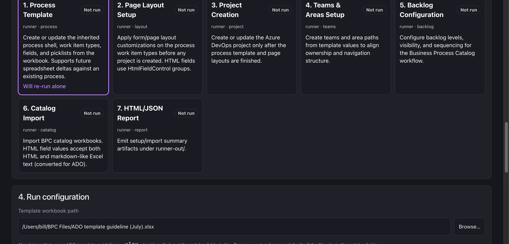
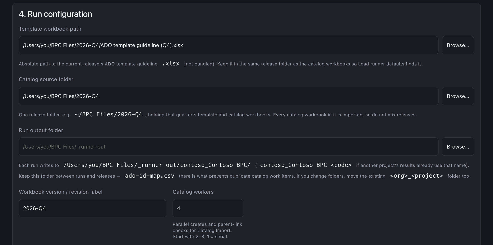
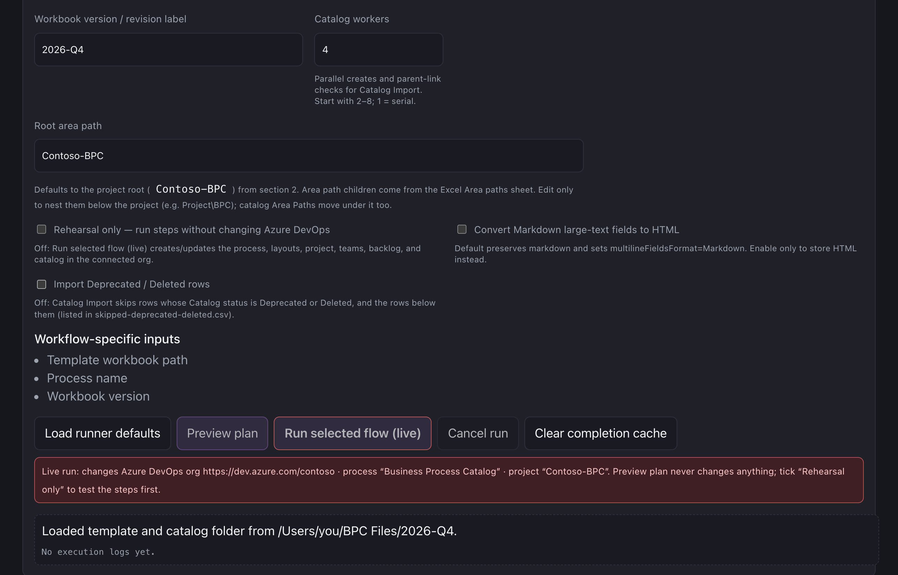
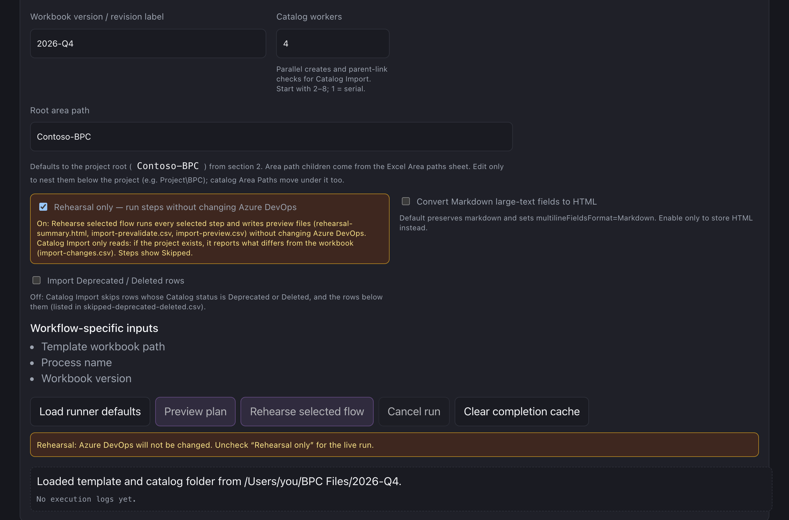

# BPC Azure DevOps React Runner

Standalone React UI + local FastAPI runner for Business Process Catalog Azure DevOps setup.

Repo entry: [../README.md](../README.md).

Excel remains the authoring format. The runner parses workbooks into an intermediate representation (IR), plans the run, and applies changes through Azure DevOps REST APIs.

**This app does not spawn the Microsoft reference Python scripts.**  
**Not tied to one release** — the template, catalog workbooks, and scripts are refreshed quarterly; point BPCTool at the current quarter's files.  
**The local runner starts automatically with the UI** — no second terminal.

| Doc | Contents |
|-----|----------|
| **[USER_GUIDE.md](./USER_GUIDE.md)** | Requirements, install, step-by-step usage, modes, Excel sheets, API, troubleshooting |
| **[CHANGELOG.md](./CHANGELOG.md)** | What changed in the standalone rebuild and later releases |
| **[docs/workflow-and-script-comparison.md](./docs/workflow-and-script-comparison.md)** | Workflow steps, quarterly releases, X vs H, catalog, incremental re-runs & conflicts, reference scripts vs BPCTool |
| **[docs/reference/](./docs/reference/)** | Post-create process template analysis (MSBPC snapshot) |

---

## Launch (no command line)

**macOS:** double-click `Start BPCTool.command`  
**Windows:** double-click `Start BPCTool.bat`

First launch installs npm + Python dependencies if needed, then starts the UI and local runner and opens your browser. Leave that window open while you work; close it to stop.

Prerequisites (installed once on the machine):

- Node.js 20+
- Python 3.11+

---

## Optional: developers

```bash
npm run setup   # ensure node_modules + .venv
npm start       # UI + auto-started runner (opens browser)
```

Advanced: `npm run runner` still starts only the API if you need it alone. Prefer `npm start` so Vite replaces a stale process on port `8787` and enables `--reload`.

---

## Screenshots

Sample UI (local Runner mode). Paths and names in the shots are illustrative.

### Connection (org URL, PAT, Multivalue preflight)


### Workflow steps



### Run configuration (template, catalog folder)



### Catalog workers and run actions

Live run: the button reads **Run selected flow (live)** and a red note names the org, process and project that will be changed.



Rehearsal: with **Rehearsal only** ticked, the button reads **Rehearse selected flow** and an amber note confirms Azure DevOps will not be changed. See [Preview plan vs Rehearsal only vs live run](./USER_GUIDE.md#preview-plan-vs-rehearsal-only-vs-live-run).



---

## Folder layout

Put each quarterly release in its own folder, template and catalog workbooks together:

```text
~/BPC Files/
  2026-Q4/
    ADO template guideline (…).xlsx
    Business Process Catalog ….xlsx · Deliverables ….xlsx · Objectives ….xlsx · SbD Delivery Plan ….xlsx
  2026-Q3/ …        _archive/ (ignored)
```

BPCTool pre-fills the newest release folder, its template, and the release name as Workbook version. Run outputs (including `ado-id-map.csv`, which prevents duplicate catalog items on later runs) go to `runner-out/<org>_<project>/` — keep that folder, or move it outside the app with `BPCTOOL_OUTPUT_DIR` in `bpctool.env` (copy `bpctool.env.example`). Details: [USER_GUIDE §2 Folder layout](./USER_GUIDE.md#folder-layout-recommended).

## First-run checklist (in the browser)

1. **Connection** — org URL + PAT (session-only) → Ready
2. Confirm **Multivalue: installed** (DevLabs Multivalue control is **required** for process / layout / project). Use **Check** / **Install**, or accept the Run-time install prompt. Marketplace: [Multivalue control](https://marketplace.visualstudio.com/items?itemName=ms-devlabs.vsts-extensions-multivalue-control)
3. **Execution mode** → **Runner** (default)
4. **Process & project names** — enter names; optional **project description**; set update policy
5. **Workflow selection** — default **Selected step only**, or Dependency-aware / Full
6. **Run configuration** — confirm the pre-filled **Template workbook path**, **Catalog source folder** (one release folder), and **Workbook version**; use **Browse…** or **Load runner defaults** to change them
7. **Preview plan** — reads the workbooks and shows steps/counts/warnings (never contacts ADO)
8. Optional: tick **Rehearsal only** → **Rehearse selected flow** runs every step and writes preview files, still without changing ADO
9. Untick **Rehearsal only** → **Run selected flow (live)**. The red note under the buttons names the org, process, and project that will change

Preview plan ignores the checkbox; the checkbox only switches the run button between rehearsal and live. Comparison table: [USER_GUIDE §5](./USER_GUIDE.md#preview-plan-vs-rehearsal-only-vs-live-run).

Defaults:

- Folder root: `~/BPC Files` (`BPCTOOL_CATALOG` to change); newest release subfolder is selected
- Template: **not bundled** — newest `ADO template guideline*.xlsx` in the release folder (or Browse… / `BPCTOOL_TEMPLATE`)
- Workbook version: release folder name (e.g. `2026-Q4`), else blank
- Root area path: project name (project root)

**Requirement:** Microsoft DevLabs **Multivalue** extension on the target org (see step 2).

Artifacts: `runner-out/<org>_<project>/` (or `BPCTOOL_OUTPUT_DIR`) — back it up; it is shared by every release and re-run.

---

## Workflow order

1. Process template (WITs, picklists, fields; multi-select → suggested lists; disables Excel-disabled types such as Epic / Feature / User story)
2. Page layouts (before any project; DevLabs multivalue control for Multi-select fields)
3. Project create/bind (optional user description)
4. Teams & areas (multi-path team assignments)
5. Backlog & iterations (levels from **Backlogs** sheet + WIT mapping + team iterations)
6. Catalog import (parallel + resume + parent-link backfill; all matching workbooks in the catalog folder)
7. HTML/JSON report

## Execution modes

| Mode | Purpose |
|------|---------|
| **Runner** (default) | Full Excel→IR→apply engine (auto-started locally) |
| **API** | Live ADO **reads** via `/ado-proxy` |
| **Simulate** | Local stubs for UI/orchestration testing |

## Run modes (workflow selection)

| Mode | Behavior |
|------|----------|
| **Selected step only** (default) | Re-run the selected card alone (no prerequisite gating) |
| **Dependency-aware** | Selected card plus incomplete prerequisites |
| **Full** | All incomplete steps in engine order |

## Excel → Azure DevOps (highlights)

- **Backlogs** sheet: rename/create levels (Epic→Levels, Feature→Lowest, Stories→Deliverables, new Highest/Kanban), set default WITs, assign enabled WITs from **Work item types**
- **Disabled** WIT rows stay in IR so Process can disable them in ADO
- Duplicate custom backlog levels left by older applies are healed on re-run (system Epics/Features preferred)
- **Multi-select** fields (Application family, Products, Industries, …): suggested picklists + DevLabs multivalue form control so `A; B` values import
- **DevLabs Multivalue extension is required** on the org for process / layout / project (Connection preflight + Run install prompt; Marketplace/admin if PAT cannot install)
- **Catalog Import** loads every matching `.xlsx` in the catalog folder (not only Business Process Catalog); parent links follow **Title 1..N** (ADO CSV outline), not Process sequence ID
- Catalog **prevalidate**: strip hard-fail values, apply Fields-sheet defaults, **case-insensitive** picklist align → `import-prevalidate.json`
- Catalog **parallel create** (UI **Catalog workers**), **resume** via `ado-id-map.csv`, parallel **parent-link backfill** that skips links made at create → `backfill-links-report.csv`
- Catalog **progress bar** with ETA; Runner **Cancel run** stops the job cooperatively; reloading the page **reattaches** to a running job
- Empty spreadsheet **Description** → no `System.Description` on create (no “Imported from … row N” text)
- Org URL accepts `dev.azure.com/{org}`, `{org}.visualstudio.com`, or bare org name

## Rich text

- **HTML** from Excel → always preserved  
- **Markdown** → preserved by default (+ `multilineFieldsFormat=Markdown` on create)  
- Empty Description → omitted (not invented)  
- Optional UI: **Convert Markdown large-text fields to HTML**  

Details: [USER_GUIDE.md §8](./USER_GUIDE.md#8-rich-text-html-vs-markdown).

## Catalog & artifacts (quick)

Catalog is **create-only for fields** (no in-place upsert). Re-runs **resume** from `ado-id-map.csv`. Typical outputs under `runner-out/<org>_<project>/`:

| File | Role |
|------|------|
| `import-preview.csv` | Sample drafts (also on Rehearsal only runs) |
| `import-prevalidate.json` | Preflight counts (incl. `picklist_case_normalized`, defaults, strips) |
| `ado-id-map.csv` | Created ids + resume map (`ParentKey` / `ParentId`) |
| `backfill-links-report.csv` | Parent-link backfill statuses |
| `import-failures.json` | Per-row ADO create errors |

Full usage and troubleshooting: [USER_GUIDE.md §9](./USER_GUIDE.md#9-workflow-steps-engine) and [§15](./USER_GUIDE.md#15-troubleshooting).

## Tests

```bash
npm test
cd runner && ../.venv/bin/pytest -q
npm run lint && npm run build
```

## API (local runner)

Auto-started on `127.0.0.1:8787`, proxied as `/api/*` from Vite:

- `GET /health`, `GET /defaults`
- `POST /plan/dry-run`, `POST /ir/parse`
- `POST /jobs`, `GET /jobs/{id}?since=N`, `POST /jobs/{id}/cancel`

Full request fields (including `project_description`) and curl examples: [USER_GUIDE.md §12](./USER_GUIDE.md#12-local-runner-api).

---

## License

[CC0 1.0 Universal](../LICENSE) — dedicated to the public domain.
